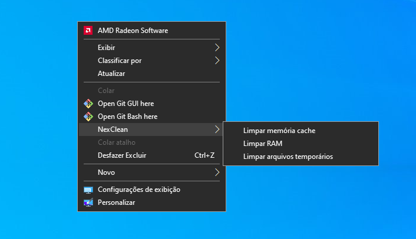

# NexClean

  <strong>A lightweight Windows cleanup utility.</strong>
   
  Fast, simple and convenient Windows cleanup tools.

  

  
  
  
  

---

## About

NexClean is a lightweight Windows utility designed to provide quick access to system cleanup operations through an intuitive interface and the Windows context menu.

Its goal is to make common cleanup tasks easier and more accessible.

## Screenshots

Take a look at NexClean in action.

  

## Features

- **Temporary Files Cleanup:** Removes temporary files from selected Windows directories, skipping files that are locked or inaccessible.
- **RAM Optimization:** Attempts to reduce the working set of the NexClean process.
- **Standby Memory Cleanup:** Requests Windows to purge the Standby List.
- **Windows Context Menu:** Quick access to cleanup operations from the desktop, files and folders.

## Download

Get the latest version of NexClean:

  

1. Download `NexClean-Setup.exe`.
2. Run the installer.
3. Follow the installation instructions.
4. Start using NexClean from the Windows context menu.

## System Requirements

- Windows 10 or later (64-bit).
- No Godot installation required.
- No .NET SDK installation required.

Administrative permissions may be required for certain cleanup operations.

## Development Requirements

For developers who want to build or modify NexClean:

- Godot Engine 4.7.2 .NET edition.
- .NET 8 SDK.
- Windows 10 or later.

## Important Notes

- Windows may recreate temporary files and cached data after cleanup.
- Some files cannot be removed while they are in use or protected by Windows.
- RAM optimization currently targets the NexClean process itself. It does not clear the working sets of other applications.
- Standby List cleanup uses an undocumented Windows native API. Its behavior and availability may vary between Windows versions.
- Some cleanup operations may require administrative privileges.

## Technologies

- Godot Engine 4.7.2
- C#
- .NET 8
- GDScript
- Windows API

## License

This project is licensed under the MIT License. See the [LICENSE](LICENSE) file for details.

## Project Status

NexClean is under active development.

---

  Developed by <strong>Guilherme Palhano</strong>

